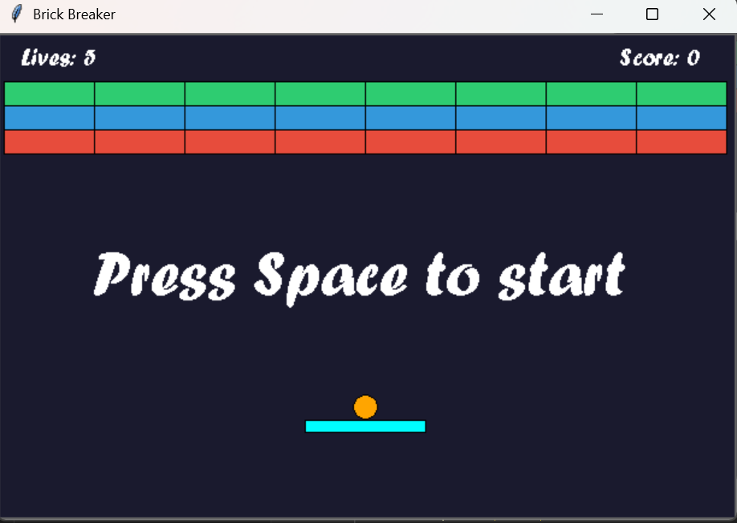

# Brick Breaker (Tkinter)

Game Brick Breaker sederhana yang dibuat dengan Python dan Tkinter. Kode ini dimodifikasi dari game Breakout bawaan tugas tanpa mengubah struktur kelas dan method aslinya.

## Cara Menjalankan

1. Pastikan Python 3 sudah terpasang.
2. Tkinter biasanya sudah bawaan Python. Di Linux, pasang dengan `sudo apt install python3-tk`.
3. Jalankan file game:

```bash
python game.py
```

> Jangan menamai file `tkinter.py` karena akan bentrok dengan library Tkinter.

## Cara Bermain

| Tombol | Fungsi |
|---|---|
| Spasi | Memulai game |
| Panah Kiri | Menggerakkan paddle ke kiri |
| Panah Kanan | Menggerakkan paddle ke kanan |

- Pantulkan bola dengan paddle agar tidak jatuh ke bawah.
- Hancurkan semua brick untuk menang.
- Setiap brick yang terkena bola menambah skor 10.
- Kalau bola jatuh, nyawa berkurang. Game berakhir saat nyawa habis.

## Jenis Brick

| Warna | Jumlah pukulan |
|---|---|
| Hijau | 3 kali |
| Biru | 2 kali |
| Merah | 1 kali |

Warna brick berubah setiap kali dipukul sesuai sisa pukulannya.

## Struktur Kode

| Kelas | Fungsi |
|---|---|
| `GameObject` | Kelas induk: posisi, gerak, dan hapus objek di canvas |
| `Ball` | Bola: gerak, pantul dinding, dan tabrakan |
| `Paddle` | Papan pemukul yang digerakkan pemain |
| `Brick` | Balok dengan jumlah pukulan dan warna berbeda |
| `Game` | Kelas utama: canvas, nyawa, skor, dan game loop |

## Modifikasi dari Kode Asli

| Bagian | Sebelum | Sesudah |
|---|---|---|
| Warna bola | putih | oranye |
| Paddle | lebar 80, kuning | lebar 100, cyan |
| Warna brick 3 pukulan | `#222222` | `#2ecc71` (hijau) |
| Nyawa | 3 | 5 |
| Skor | tidak ada | ada, +10 per brick (method `update_score_text`) |
| Background | `#aaaaff` | `#1a1a2e` (gelap) |
| Susunan brick | atas 2, tengah 1, bawah 1 pukulan | atas 3, tengah 2, bawah 1 pukulan |
| Gerak paddle | 10 per tekan | 20 per tekan |
| Kecepatan loop | 50 ms | 40 ms |
| Warna teks | hitam | putih |
| Judul window | Hello, Jarvis! | Brick Breaker |

Semua baris yang diubah ditandai komentar `# MODIF` di dalam kode.




